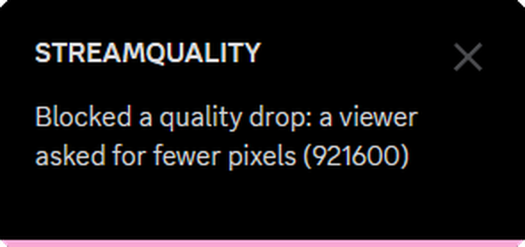

# StreamQuality

Un plugin per [Vencord](https://vencord.dev) che mantiene la condivisione schermo di Discord alla qualità che scegli tu.

Forza il bitrate e i fotogrammi della tua diretta Go Live, impedisce a Discord e a chi guarda di abbassarli di nascosto e ti avvisa quando blocca un calo.

**English:** [read the guide in English](README.md)

## Cosa fa

- **Bitrate forzato.** Imposta il bitrate obiettivo, minimo e massimo della tua stream (di base 9000, 4000 e 9000 kbps).
- **Fotogrammi forzati.** 30 o 60 fps, anche se qualcuno cambia il menu stream di Discord.
- **Risoluzione fissa, se vuoi.** Tieni quella che scegli su Discord, oppure ne forzi una che il menu stream di Discord non può cambiare, anche ultrawide come 2560x1080.
- **Ignora le richieste di abbassare la qualità.** Quando uno spettatore rimpicciolisce la finestra della stream, Discord chiede al tuo PC di mandare meno pixel. StreamQuality continua a mandare la qualità piena.
- **Scelta del codec (sperimentale).** Forza H265 (HEVC) se il tuo PC sa codificarlo: più qualità a parità di bitrate, soprattutto nel movimento. Di base decide sempre Discord.
- **Ti dice cosa ha bloccato.** Una notifica, con un suono morbido e basso se vuoi, al massimo una volta al minuto. Tutto finisce anche nel registro notifiche di Vencord.
- **Non tocca le altre stream.** Cambia solo la stream che mandi tu, mai quelle che guardi.

## Cosa non può fare

- **Superare il limite di Discord.** Nei test, il server di Discord accettava al massimo circa 9000 kbps: valori più alti non servono.
- **Rendere perfetto il movimento velocissimo.** Circa 9 Mbps in H.264 sono pochi per un gioco veloce ad alta risoluzione. Vedi i [consigli](#consigli-per-una-stream-più-nitida).
- **Sbloccare codec che Discord non supporta sul tuo PC.** L'opzione del codec sceglie solo tra quelli che Discord sa codificare con la tua scheda video (per esempio, molte schede non possono trasmettere in AV1).
- **Tenere piatto il grafico del bitrate.** Nelle scene calme l'encoder ha bisogno di meno dati e ne manda meno da solo. È normale: l'immagine resta nitida.
- **Sistemare una connessione lenta.** Vedi [Prima di iniziare](#prima-di-iniziare).

## Prima di iniziare

- **Windows** con l'**app desktop di Discord** (non il browser).
- **Una buona velocità di upload.** I 9000 kbps di base richiedono un upload stabile di almeno 12 Mbps circa. Controlla il tuo con uno speed test. Se è più basso, metti Bitrate Target e Bitrate Max a circa il 70% del tuo upload e Bitrate Min a circa la metà (per esempio 4000, 4000 e 2000 con 6 Mbps di upload).
- **Vencord compilato dal codice sorgente.** I plugin come questo funzionano solo con un Vencord compilato da te. Lo fa l'installer al posto tuo e mantiene le tue impostazioni di Vencord.

Il team di Vencord non dà assistenza sui plugin esterni: per aiuto con StreamQuality chiedi [qui](../../issues), non nel server di Vencord.

## Installazione

### Automatica (consigliata)

1. In cima a questa pagina clicca il pulsante verde **Code**, poi **Download ZIP**.
2. Tasto destro sullo ZIP → **Estrai tutto**.
3. Apri la cartella estratta e fai doppio clic su **Install.bat**.
   Se Windows mostra un avviso, clicca **Ulteriori informazioni → Esegui comunque** (oppure **Esegui**).
4. Segui la finestra. L'installer:
   - installa Git e Node.js se mancano (Windows potrebbe chiederti il permesso)
   - installa pnpm
   - aggiorna la tua cartella di Vencord se lo compili già tu (nella cartella utente o in Documenti), altrimenti scarica Vencord in `C:\Users\<tuo nome>\Vencord`
   - aggiunge StreamQuality e compila Vencord
   - ti chiede se installare Vencord in Discord: la prima volta rispondi **Y**, poi scegli il tuo Discord con le frecce e premi Invio
5. Chiudi Discord del tutto: tasto destro sull'icona vicino all'orologio → **Esci da Discord**. Poi riaprilo.
6. Vai in **Impostazioni utente → Vencord → Plugins**, cerca **StreamQuality** e attivalo.

### Manuale (se compili già Vencord)

1. Nella cartella di Vencord crea `src\userplugins\streamQuality`.
2. Mettici dentro il file `index.ts` di questa pagina.
3. Esegui `pnpm build` nella cartella di Vencord.
4. Riavvia Discord del tutto e attiva StreamQuality.

Guida ufficiale di Vencord: [installare plugin esterni](https://docs.vencord.dev/installing/custom-plugins/) (in inglese).

## Impostazioni

| Impostazione | Di base | Cosa fa |
|---|---|---|
| Resolution | Same as Discord | Tiene la risoluzione scelta nel menu stream di Discord, oppure ne forza una che il menu non può cambiare |
| Framerate | 60 fps | Fotogrammi al secondo della stream. Il menu stream di Discord non può cambiarli |
| Bitrate Target | 9000 | Il bitrate a cui punta Discord, in kbps |
| Bitrate Min | 4000 | Il bitrate più basso a cui Discord può puntare. Con una connessione veloce e stabile puoi alzarlo a 7000 |
| Bitrate Max | 9000 | Il bitrate più alto. Circa 9000 è il limite di Discord |
| Ignore Viewer Requests | Attivo | Mantiene la qualità piena quando chi guarda ne chiede meno |
| Video Codec | Automatic | Forza un codec per la stream e la webcam (sperimentale). Dopo averlo cambiato riavvia Discord |
| Notify Blocked | Attivo | Mostra una notifica quando blocca un calo di qualità |
| Sounds | Attivo | Suono morbido e basso: due note che salgono quando parte la stream, due tocchi brevi quando blocca un calo |
| Sound Style | Plugin sound | Oppure il suono dei messaggi di Discord |
| Sound Volume | 30 | Da 0 a 100 |
| Debug | Spento | Scrive nella console sviluppatore cosa manda Discord |

Le impostazioni di StreamQuality vincono sul menu stream di Discord: i fotogrammi sempre, la risoluzione a meno che tu non la lasci su **Same as Discord**. In quel caso scegli la risoluzione su Discord: quando scegli cosa condividere, clicca l'ingranaggio in basso a destra, scegli **Personalizzato** e imposta la risoluzione (per esempio **Sorgente**).

## Consigli per una stream più nitida

- **Prova H265.** Metti Video Codec su **H265 / HEVC** e riavvia Discord. Nel Debug della stream il campo Codec deve dire H265. Se uno spettatore non vede la stream, il suo PC non sa riprodurre H265: rimetti Automatic.
- **Togli film grain, motion blur e aberrazione cromatica** dai giochi. Cambiano tutti i pixel in ogni fotogramma, ed è la cosa più difficile da comprimere. Spesso questo da solo aiuta più di qualsiasi impostazione.
- **Scegli in base agli schermi di chi guarda.** Se i tuoi amici guardano da monitor 1080p, una stream 1080p per loro è nitida uguale e lascia più dati per ogni pixel.
- **Giochi lenti: prova 30 fps.** Ogni fotogramma riceve il doppio dei dati.

## Come capire se funziona

- Quando parte la stream vedi **Active: …** (e senti due note basse, se i suoni sono attivi).
- Quando Discord o uno spettatore provano ad abbassare la qualità vedi **Blocked a quality drop: …**, seguito da cosa avevano chiesto. Il calo non è avvenuto: le tue impostazioni restano quelle.
- Se senti il suono ma non vedi la notifica, Discord non era in primo piano e Vencord l'ha mandata come notifica di Windows. Nelle impostazioni notifiche di Vencord metti lo stile su **Always use Vencord notifications**, oppure guarda **Notification Log** nelle impostazioni di Vencord.

## Aggiornare

Scarica il nuovo ZIP e avvia di nuovo **Install.bat**. Le tue impostazioni restano.

## Disinstallare

- Per spegnerlo: disattiva StreamQuality in **Vencord → Plugins**.
- Per toglierlo: elimina la cartella `src\userplugins\streamQuality` dentro la cartella di Vencord (di solito `C:\Users\<tuo nome>\Vencord`), esegui `pnpm build` nella cartella di Vencord e riavvia Discord del tutto.

## Domande frequenti

**Posso essere bannato?**
Le mod del client come Vencord vanno contro i Termini di servizio di Discord. Vencord dice che non si conoscono casi di utenti bannati per averle usate, ma le usi a tuo rischio.

**Funziona nel browser, su Vesktop, macOS o Linux?**
È stato fatto e provato su Windows con l'app desktop di Discord, e si aggancia al motore video di quell'app. Il browser non è supportato, il resto non è stato provato.

**Perché il bitrate scende sotto il minimo?**
Nelle scene calme all'encoder servono meno dati. Il minimo impedisce a Discord di puntare più in basso, ma non può costringere l'encoder ad aggiungere dati che non servono.

**La stream si blocca o va a scatti.**
Probabilmente il tuo upload è troppo lento per quel bitrate. Abbassa Bitrate Target, Min e Max (vedi [Prima di iniziare](#prima-di-iniziare)).

**Install.bat dice che qualcosa è andato storto.**
Il messaggio rosso dice cosa non ha funzionato. Il caso più comune: Git o Node.js sono appena stati installati e Windows non li vede ancora. Chiudi la finestra e avvia di nuovo Install.bat. Se non funziona ancora, [apri una segnalazione](../../issues) con uno screenshot.

## Crediti

- Creato da ARA.
- Basato su [Vencord](https://github.com/Vendicated/Vencord).
- Ispirato a [BetterScreenshare](https://github.com/philhk/Vencord/tree/better-plugins) di philhk.
- L'opzione del codec usa lo stesso aggancio a Discord di [StreamingCodecDisabler](https://github.com/Equicord/Equicord/tree/main/src/equicordplugins/streamingCodecDisabler) di Equicord.

## Supporto

StreamQuality è gratuito. Se ha migliorato le tue stream, puoi [offrirmi un caffè su Ko-fi](https://ko-fi.com/arakirae). Hai trovato un problema o hai un'idea? [Apri una segnalazione](../../issues).

## Licenza

[GPL-3.0-or-later](LICENSE). Puoi usare, modificare e condividere StreamQuality liberamente, purché quello che condividi resti con la stessa licenza.

StreamQuality non è collegato a Discord né a Vencord.
